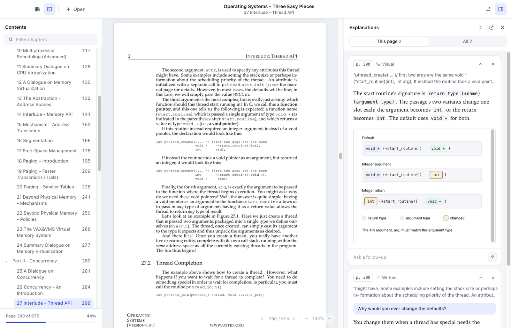
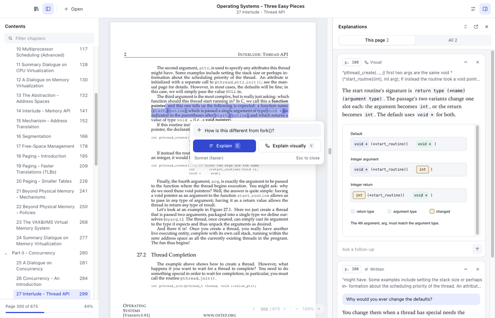
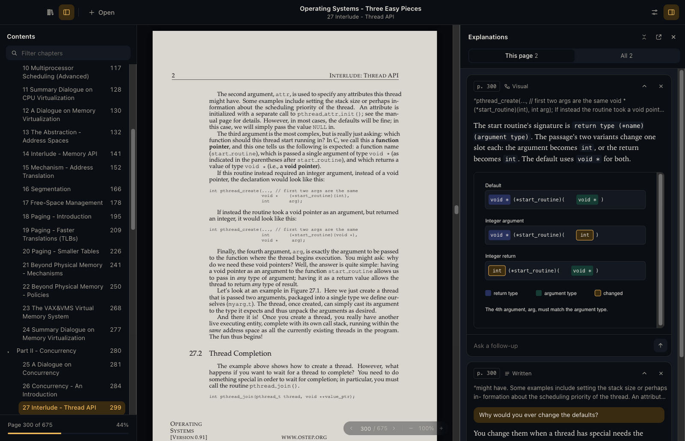
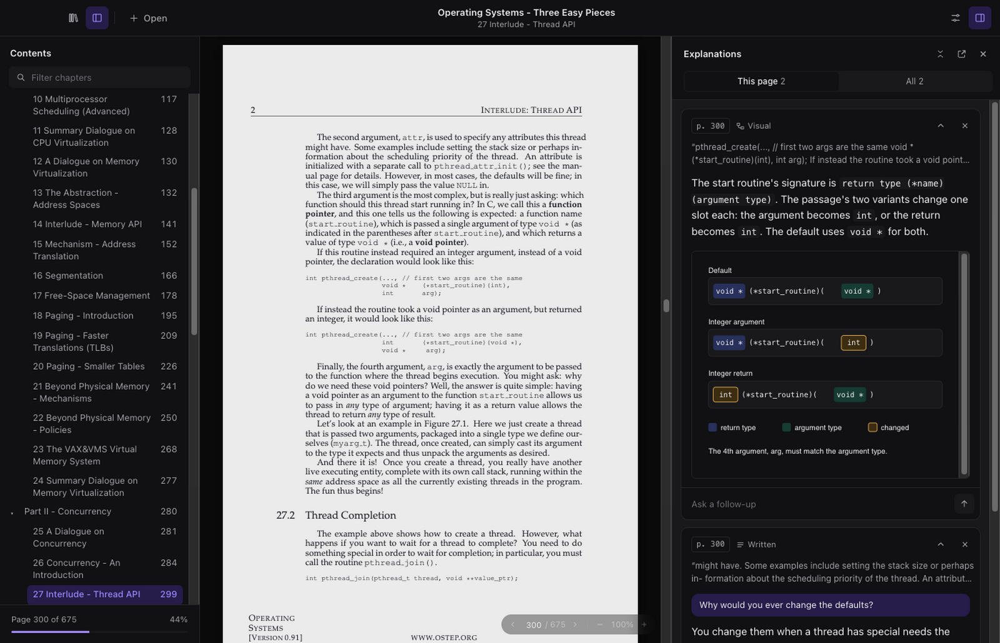

# Agentic Reading

A desktop reader for PDFs and EPUBs that explains any passage. Select text, then choose **Explain** for a short written explanation or **Explain visually** for a drawing (a labelled diagram, flow or small chart) that appears next to the page.

It uses your Claude subscription through the [Claude Code](https://claude.com/claude-code) CLI you already have signed in. There's no API key and no separate account.



Select a passage to explain it, optionally with your own question:



| Night Library | Graphite & Violet (dark) |
| --- | --- |
|  |  |

<sub>Book shown: [Operating Systems: Three Easy Pieces](https://pages.cs.wisc.edu/~remzi/OSTEP/) by Remzi and Andrea Arpaci-Dusseau, free online.</sub>

## Run it

Requires Node 20+ and the `claude` CLI, installed and signed in (run `claude` once in a terminal if you haven't).

```bash
npm install
npm start          # builds, then opens the app
```

After the first build, `npx electron .` opens it without rebuilding.

### Install as a Mac app

```bash
npm run dist       # builds release/Agentic Reading-<version>-arm64.dmg
```

Open the DMG and drag the app to Applications. It shares its library with `npm start`, and still needs the `claude` CLI signed in. The build is signed ad hoc, not notarised: it opens normally on the Mac that built it, but a copy downloaded on another Mac needs `xattr -cr "/Applications/Agentic Reading.app"` before it will open. The icon comes from `build/icon.svg` (`npx electron scripts/make-icon.mjs` re-renders it).

## Use

- **Open a book:** click Open (⌘O), drop a PDF or EPUB on the window, or pick one in the library. The library is the home screen: the book you were last reading, with how far you are, and the others you've opened. The books icon at the top left goes back to it. File → Open recent works too.
- **Read:** scroll through the book continuously, or use the ← → keys. The small bar in the bottom-right corner of the page shows where you are: click the number to jump to a page, ‹ › to turn one, − + to zoom. It stays faint until you point at it. The app remembers your page in each book.
- **Contents:** the sidebar lists the book's chapters, with the one you're in highlighted, a box to filter them, and how far through the book you are.
- **EPUBs** show in the reader's theme and reflow to fit the window; − + changes the type size. The book's own styles are dropped. The page box counts the book's sections (usually chapters) instead of pages, and the app remembers how far through a section you were.
- **Explain a passage:** select text, then click **Explain** (`E`) for a few sentences, or **Explain visually** (`V`) for a drawing.
- **Follow up:** type a question under any explainer. Follow-ups continue the same conversation and keep its style, so Claude remembers the passage.
- **No contents in the PDF?** Click **Generate with AI** in the Contents sidebar. It reads the book's headings and any printed contents page, and the result is saved with the book. **Regenerate** and **Remove** sit at the top of the list.
- **Move the explanations:** the button at the top of the panel opens it in its own window (closing that window, or the same button, puts it back). × hides it; the panel button at the top right brings it back. **This page** shows only the explanations for the page you're reading; **All** shows the whole book's.
- **Pick a theme** in the settings menu (the sliders at the top right): Paper & Ink, Graphite & Violet and Forest Study follow your system's light or dark mode; Night Library is always dark and dims the page. Drawings follow the theme. Themes live in `shared/themes.ts`.
- **Pick a model** in the same menu: Haiku is fastest, Sonnet is faster, Opus gives the best results, or try Fable 5.2.
- Explainers are saved per book. Click a card's page badge (`p. 12`, or `§ 3` in an EPUB) to jump back to it; in an EPUB it scrolls to the passage itself.

## How it works

| Piece | What it does |
| --- | --- |
| `electron/explainer.ts` | Turns a request into an explanation with whichever provider is selected: builds the prompts, carries the conversation for follow-ups, streams progress and parses the reply |
| `electron/llm/provider.ts` | The `LlmProvider` interface, the only way the app talks to a model |
| `electron/llm/claude-cli.ts` | The Claude Code provider. Runs `claude -p` headless with streaming JSON output, no tools, no user or project settings and no MCP servers. It removes `ANTHROPIC_API_KEY` from the environment so the CLI uses your subscription, and resumes follow-ups from the CLI's session. |
| `electron/llm/index.ts` | The list of available providers |
| `electron/contents.ts` | Generates a table of contents for PDFs without one, through the same providers, and checks the reply |
| `src/contents-source.ts` | Reads the PDF for contents generation: the front pages' text, and heading-like lines picked out by font size |
| `electron/prompt.ts` | The system prompts, one per mode: a short `<explanation>`, or a caption plus a static `<widget>` drawing and the design rules it follows |
| `electron/widget.ts` | Wraps each widget with theme tokens and base styles. Each widget runs at `widget://` in an iframe sandboxed to `allow-scripts`, under a CSP that only allows cdnjs, jsDelivr and unpkg |
| `electron/main.ts` | Window, File menu, the `app://` and `widget://` protocols, and IPC |
| `electron/store.ts` | `state.json` in the app's data folder: recent books, page per book, saved explainers, settings |
| `src/main.ts` | The renderer: picks the PDF or EPUB view, selection, explainer cards with live streaming |
| `src/pages.ts` | The PDF view: PDF.js pages and text layers, drawn only near the visible area |
| `src/epub.ts` | The EPUB view: unzips the book, reads its spine and table of contents, and shows each section as clean markup (no scripts, styles or classes from the book) |

### Adding a model provider

Model access is behind one interface, so supporting a local model or an API means adding a provider, not changing the app:

1. Create `electron/llm/<name>.ts` with a class that implements `LlmProvider`: an `id`, a `label`, its `models` and a `chat()` method. `chat()` gets the system prompt and the whole conversation as messages, streams text through `onText`, and stops when `signal` aborts.
2. Add it to the list in `electron/llm/index.ts`.

The model menu groups models by provider once there's more than one. Conversations are saved as plain messages, so follow-ups keep working when someone switches provider. A provider that can resume a conversation more cheaply (like the Claude CLI's sessions) can return a `resume` handle; others can ignore it.

## Testing

```bash
npm run build
VR_SELFTEST="/path/to/book.pdf" VR_SELFTEST_PAGE=300 npx electron .
```

To refresh the screenshots above (two real requests, in an empty profile):

```bash
npm run build
VR_SELFTEST_PROFILE=agentic-reading-screenshots VR_SELFTEST_SCREENSHOTS="$PWD/docs/screenshots" \
  VR_SELFTEST="/path/to/ostep.pdf" VR_SELFTEST_PAGE=300 npx electron .
```

The self-test opens the book in a throwaway profile, selects part of the page and clicks Explain. It waits for the explainer and saves screenshots to `selftest-out/`, including the widget on its own. It makes one real request through your subscription. Set `VR_DEBUG=1` to log the CLI's events.
